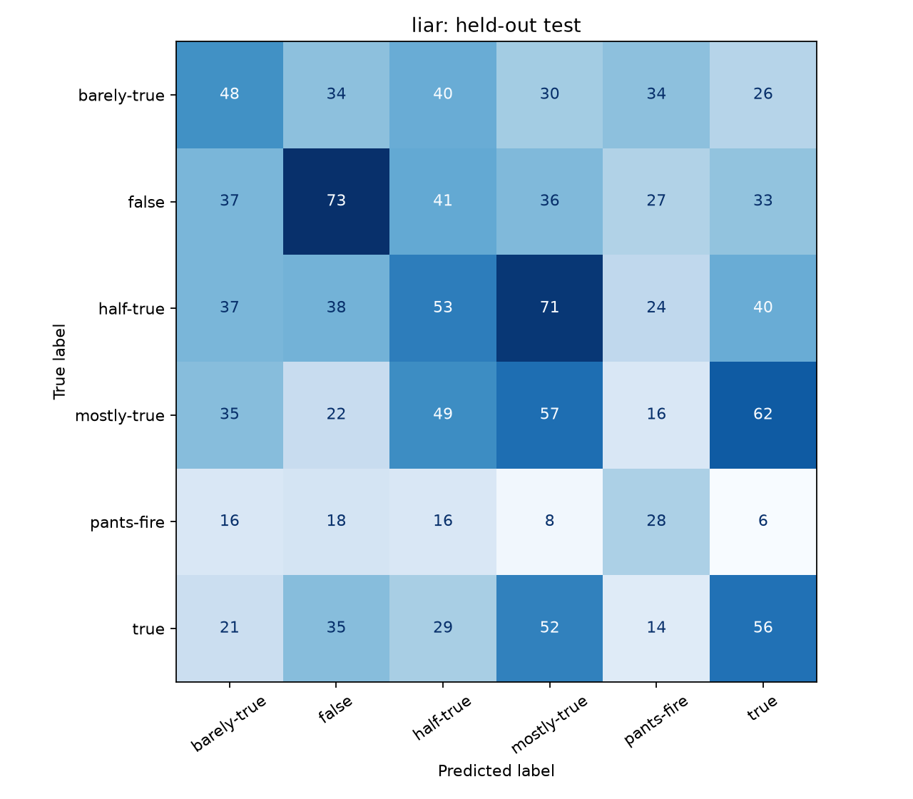
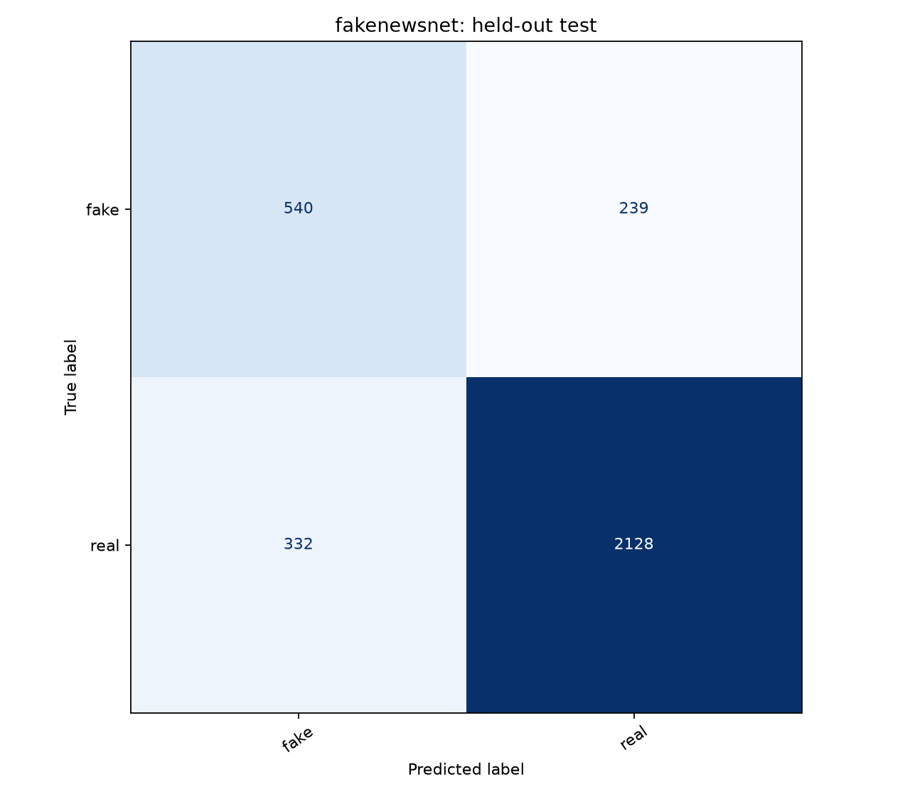
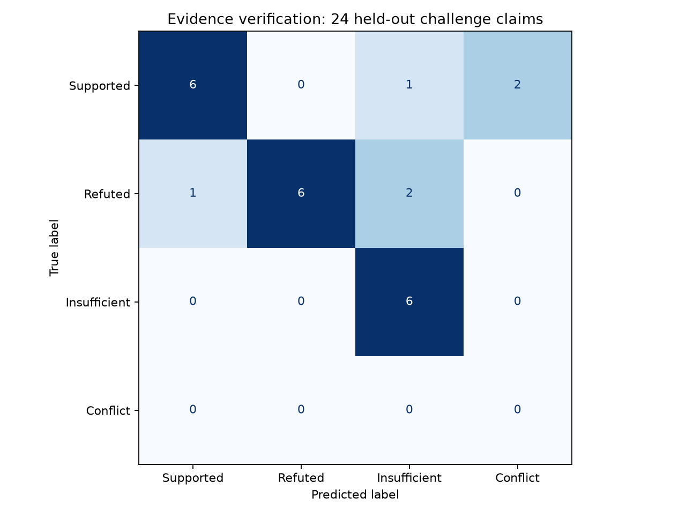

# Գործնական աշխատանք. կեղծ լուրերի հայտնաբերում և ճշգրտում

## 1. Իրականացված համակարգը

Իրականացվել է վերարտադրվող հետազոտական համակարգ՝ երկու տեքստային դասակարգիչով, աղբյուրների որոնմամբ, ապացույց–պնդում իմաստային համեմատությամբ և աղբյուրից վերցված ուղղման առաջարկով։ Ծրագիրն ունի հայերեն տեղային միջերես, իսկ մուտքային տեքստերը և ուսուցման տվյալներն անգլերեն են։ LIAR-ը օգտագործվում է անգլերեն պնդումների վեցաստիճան դասակարգման, FakeNewsNet-ը՝ անգլերեն վերնագրերի fake/real դասակարգման համար։ Այս խնդիրներն ունեն տարբեր դասեր և բարդություն, ուստի դրանց տոկոսները ուղղակի համեմատելի չեն։

## 2. Տվյալների նախնական մշակում

Կիրառվում են Unicode NFKC նորմալացում, HTML նշագրերի հեռացում, HTML entity-ների փոխակերպում, URL-ի ընդհանուր նշիչ, փոքրատառերի փոխակերպում և բացատների կարգավորում։ Թվերը և ժխտումը պահպանվում են։ Stopword-ների հեռացում և լեմատացում չեն կիրառվել։ Պիտակների հակասող օրինակները հեռացվում են, կրկնվող նորմալացված տեքստից պահպանվում է մեկ օրինակ։

| Հավաքածու | Սկզբնական | Հակասող տողեր | Կրկնություններ | Մնացած | Train / Valid / Test |
|---|---:|---:|---:|---:|---|
| liar | 12791 | 16 | 24 | 12751 | 10212 / 1277 / 1262 |
| fakenewsnet | 23196 | 369 | 1239 | 21588 | 15111 / 3238 / 3239 |

LIAR-ում պահպանված են պաշտոնական բաժանումները՝ մաքրումից հետո։ FakeNewsNet-ի բաժանումը 70/15/15 է՝ seed=42, աղբյուրի և դասի համատեղ շերտավորմամբ։ Բաժանումների միջև նորմալացված ճշգրիտ տեքստային համընկնումների թիվը 0 է։ Տվյալների ամբողջության վրա նախնական հակասությունների մաքրումը փոխում է գնահատվող պոպուլյացիան։ Թեմատիկ կամ մոտ իմաստային կրկնությունները ամբողջությամբ չեն բացառվել։

## 3. Հատկանիշների դուրս բերում

Օգտագործվում է TF-IDF՝ մեկ և երկու բառից կազմված n-gram-ներով, min_df=2, max_df=0.98, առավելագույնը 60,000 հատկանիշ և sublinear_tf=True։ Բառապաշարը և IDF կշիռները հաշվարկվում են միայն ուսուցման հավաքածուից։ Գնահատման տվյալները չեն մասնակցում հատկանիշների ուսուցմանը։ URL-ները, աղբյուրի անունը և LIAR-ի պիտակից կախված խոսնակի հաշվիչները մոդելի մուտք չեն։

## 4. Սկզբնական մոդելների իրականացում

Համեմատվել են majority baseline, Complement Naive Bayes, Logistic Regression և Linear SVM մոդելները։ Երկու վերջիններում կիրառվում է դասերի հավասարակշռված կշռում։ Ընտրության միակ չափանիշը validation macro-F1-ն է։ Ընտրված մոդելը պահպանվում է joblib ձևաչափով և օգտագործվում է FastAPI ծառայությունում։

### liar: validation արդյունքներ

| Մոդել | Accuracy | Macro-F1 |
|---|---:|---:|
| logistic_regression | 25.76% | 25.96% |
| linear_svm | 24.67% | 24.90% |
| complement_nb | 25.14% | 24.88% |
| majority | 19.42% | 5.42% |
### fakenewsnet: validation արդյունքներ

| Մոդել | Accuracy | Macro-F1 |
|---|---:|---:|
| logistic_regression | 82.00% | 76.88% |
| complement_nb | 82.95% | 76.36% |
| linear_svm | 81.90% | 76.21% |
| majority | 75.94% | 43.16% |

## 5. Սկզբնական թեստային գնահատում

| Հավաքածու | Ընտրված մոդել | Accuracy | Macro precision | Macro recall | Macro-F1 |
|---|---|---:|---:|---:|---:|
| liar | logistic_regression | 24.96% | 24.72% | 25.58% | 24.90% |
| fakenewsnet | logistic_regression | 82.37% | 75.91% | 77.91% | 76.79% |

F1 = 2 × precision × recall / (precision + recall)։ Macro-F1-ը դասերի F1-երի չկշռված միջինն է։ Այն ընտրվել է որպես հիմնական չափանիշ, քանի որ հատկապես FakeNewsNet-ում դասերը անհավասարակշռված են։

liar: Macro-F1-ի 95% bootstrap միջակայքը՝ 22.40%–27.14% (500 վերանմուշառում, seed=42)։

fakenewsnet: Macro-F1-ի 95% bootstrap միջակայքը՝ 74.98%–78.48% (500 վերանմուշառում, seed=42)։

### Աղբյուրների միջև տեղափոխում

| Ուսուցման աղբյուր → թեստի աղբյուր | Accuracy | Macro-F1 |
|---|---:|---:|
| gossipcop_to_politifact | 57.82% | 52.05% |
| politifact_to_gossipcop | 47.25% | 45.55% |

Այս փորձը ցույց է տալիս աղբյուրի փոփոխության նկատմամբ զգայունություն։ Այն օգտագործում է ընտրված մոդելի նույն կառուցվածքը՝ վերաուսուցված միայն սկզբնական train-ի համապատասխան աղբյուրով։ Թիրախային test-ը չի օգտագործվում ուսուցման համար։ Փոքր PolitiFact ենթաբաժինը սահմանափակում է եզրահանգումների կայունությունը։

## 6. Ճշգրտում և ապացույցներ

LIAR-ի սկզբնական ֆայլերում փաստաստուգողների հիմնավորումները բացակայում են։ Այդ բացը լրացվել է LIAR-PLUS հետազոտական հավելումով։ Այն չի փոխարինում սկզբնական տվյալները և չի մասնակցում դասակարգիչների գնահատմանը։ 10,242 հում գրառումից ինդեքսավորվել է 10,090-ը։ Բացառվել են մաքրված train-ին չհամապատասխանող 30 գրառում, պնդման կամ պիտակի անհամապատասխանությամբ 6 գրառում և անբավարար հիմնավորմամբ 116 գրառում։

Որոնումը համատեղում է բառային TF-IDF կոսինուսային նմանությունը՝ 0.65 կշռով, և նիշային TF-IDF նմանությունը՝ 0.35 կշռով։ Ինդեքսավորվում են պնդումները։ Յուրաքանչյուր արդյունքին կցված են սկզբնական խոսնակը, համատեքստը, պատմական գնահատականը և փաստաստուգողի հիմնավորման հատվածը։ Աղբյուրների հղումները տանում են ամրագրված Git commit-ի տվյալների համապատասխան տողին, ոչ ենթադրված կամ հորինված հոդվածի հասցեին։

Ճշգրիտ համընկնումը վերադարձնում է արխիվային գնահատականն ու հիմնավորումը։ Սա պատմական տվյալ է, ոչ այսօրվա ճշմարտության վերահաստատում։ Վերաշարադրված կամ փոփոխված պնդման համար ցուցադրվում են առավելագույնը հինգ հարակից նյութեր՝ առանց դրանց գնահատականը նոր պնդմանը վերագրելու։ Արխիվային որոնումը ինքնուրույն նոր ուղղված լուր չի գեներացնում․ նոր պնդումների ուղղման առանձին մեխանիզմը նկարագրված է ստորև։ NASA-ի չորս աղբյուրով օրինակները պահպանվել են որպես նախապես կազմված ուղղման ցուցադրություն։

### Որոնման առանձին գնահատում

Փորձարկվել են նախապես կազմված 20 ձեռքով վերաշարադրված հարցումներ՝ հայտնի արխիվային թիրախներով։ Հարցումները ինդեքսի ճշգրիտ կրկնություններ չեն։ Ճիշտ նյութը առաջին տեղում գտնվել է 16 դեպքում՝ Recall@1 = 80%, առաջին հինգում՝ 20 դեպքում՝ Recall@5 = 100%։ MRR@5 = 0.8917։ Փորձը փոքր զարգացման հավաքածու է և չի հանդիսանում անկախ իրական աշխարհի փաստաստուգման benchmark։ Կշիռները արդյունքներից հետո չեն կարգավորվել։

LIAR test-ի բոլոր 1,262 պնդումները ստուգվել են ինդեքսի ճշգրիտ համընկնման նկատմամբ․ համընկնումների թիվը 0 է։ Թվերի փոփոխմամբ և ժխտման ավելացմամբ կազմված 60 դեպքերում ավտոմատ ուղղում չի տրվել։ Test-ից պատահական ընտրված 50 պնդումների համար նույնպես ուղղում չի ստեղծվել։ Այս ստուգումները հաստատում են ձեռնպահ մնալու կանոնը, ոչ փաստային ճշմարտության հայտնաբերման որակը։

Google Fact Check միակցիչը վերադարձնում է հրապարակումների հղումներ և գնահատականներ՝ համապատասխանությունը ստուգելու համար։ Այն փորձարկվել է մոդելավորված պատասխաններով, դատարկ կամ սխալ կառուցվածքով տվյալներով և ցանցային խափանումներով։ Իրական API բանալիով փորձարկումը բաց է մնում։

Աղբյուրներ՝ https://github.com/Tariq60/LIAR-PLUS և https://aclanthology.org/W18-5513/ ։ LIAR-PLUS-ը օգտագործվում է հետազոտական նպատակով։

### Նոր պնդումների ապացույցներով ստուգում

Իրականացվել է առանձին /verify շղթա՝ մուտքային տեքստի բաժանում պնդումների, աղբյուրների ստացում, համապատասխան հատվածների ընտրություն, բնական լեզվի եզրահանգման NLI մոդելի գնահատում և աղբյուրի նախադասությունից կազմված ուղղում։ Մեկ հարցումը ընդունում է մինչև հինգ կարճ պնդում։ Բարդ համակցված պնդումների դեպքում պահանջվում է դրանք բաժանել, որպեսզի մեկ մասի ապացույցը չվերագրվի ամբողջ տեքստին։

Սկզբնական աղբյուրների կորպուսը ներառում է NASA-ի տասը փաստագրական էջի պահպանված պատճենները։ Օգտատերը կարող է նշել լրացուցիչ NASA կամ անգլերեն Wikipedia հոդվածի HTTPS հասցե։ Առցանց ռեժիմում MediaWiki որոնումը ստանում է նոր հոդվածների ներածական հատվածները՝ առանց API բանալու։ Պահպանվում են աղբյուրի հասցեն, վերնագիրը, ստացման ժամանակը և տեքստի SHA-256 հեշը։ Wikipedia-ի դեպքում վերադարձվում է կոնկրետ վերանայման հասցեն։

Ապացույցների ընտրությունը սկսվում է պնդման հիմնական առարկայի համընկնումից։ Այնուհետև բառային TF-IDF-ով ընտրվում է առավելագույնը 16 հատված՝ առնվազն 0.14 կոսինուսային նմանությամբ։ Այս շեմերը լեզվական ու թեմատիկ նախնական զտիչներ են, ոչ պնդման ճշմարտության ապացույց։

Իմաստային համեմատությունն իրականացնում է cross-encoder/nli-deberta-v3-small մոդելը։ Այն իր հեղինակների կողմից նախապես ուսուցանվել է SNLI և MultiNLI տվյալներով։ Այս աշխատանքում այդ մոդելը չի վերաուսուցվել LIAR-ի կամ FakeNewsNet-ի վրա։ Մեր տվյալներով իրական ուսուցված մոդելները մնում են նախորդ բաժինների տեքստային դասակարգիչները։ NLI-ի համար օգտագործվում է ամրագրված fa2804872c3b4bd748f38c0185cc85775361e735 վերանայումը։

NLI-ն գնահատում է երեք հարաբերություն՝ հաստատում, հակասություն և չեզոքություն։ Վճռորոշ գնահատականի շեմը 0.92 է։ Սա ճշմարտության 92% հավանականություն չէ․ մոդելի ելքերը չեն կալիբրացվել իրական լուրերի հավանականությունների նկատմամբ։ Բարձր հաստատում և բարձր հակասություն միաժամանակ ունենալու դեպքում համակարգը վերադարձնում է հակասող ապացույցների վիճակ։

Հակասության դեպքում առաջարկվող ուղղումը ընտրված աղբյուրի բառացի նախադասությունն է՝ աղբյուրի վերնագրով և հղումով։ Այսպիսով համակարգը կարող է նոր մուտքային պնդման համար ինքնաշխատ կազմել աղբյուրի վրա հիմնված փոխարինող տեքստ՝ առանց ազատ գեներացմամբ նոր փաստ հորինելու։ Բազմապնդում տեքստի ամբողջական ուղղումը տրվում է միայն այն դեպքում, երբ բոլոր մասերի համար կա վճռորոշ գնահատական։ Անորոշ մասի դեպքում ամբողջական վերաշարադրում չի ներկայացվում։

### Նոր շղթայի զարգացման և թեստային գնահատում

Նախապես կազմվել են 12 զարգացման և 24 թեստային օրինակներ՝ հաստատվող, հերքվող և բավարար ապացույց չունեցող դասերով։ Զարգացման օրինակները վերաբերում են Արեգակին, Երկրին, Լուսնին և Մարսին, իսկ թեստային փաստային օրինակները՝ այլ մոլորակների։ Որոշումներն ու շեմերը ֆիքսվել են զարգացման փուլից հետո։ Թեստի արդյունքները չեն օգտագործվել հաջորդ կարգաբերման համար։

Զարգացման ընթացքում համեմատվել է նաև MiniLM տարբերակը։ Թեմային չառնչվող հատվածների սխալ հակասությունները հանգեցրել են առարկայի նախնական զտիչի ավելացմանը։ Ընտրվել է DeBERTa տարբերակը, որի զարգացման 12 օրինակներից 11-ի ելքը ճիշտ է եղել։

| Չափանիշ | Թեստային արդյունք |
|---|---:|
| Օրինակների թիվ | 24 |
| Ճիշտ ընդհանուր ելքեր | 18 / 24 |
| Accuracy | 75.00% |
| Macro-F1՝ ելքային չորս վիճակներով | 58.75% |
| Առաջարկված ուղղումներ | 6 |
| Ճիշտ հերքումներ առաջարկված ուղղումների մեջ | 6 / 6 |
| Աղբյուրի բառացի հատվածին համապատասխանություն | 6 / 6 |

Macro-F1-ի հաշվարկում ներառված է նաև կանխատեսված «հակասող ապացույցներ» վիճակը, որի համար այս փոքր հավաքածուում առանձին gold օրինակներ չկան։ Հետևաբար այս չափանիշը չի համեմատվում անմիջապես LIAR-ի կամ FakeNewsNet-ի դասակարգման F1-ի հետ։

Եղել են հինգ ձեռնպահ մնալու կամ հակասության դեպքեր՝ այն օրինակների համար, որտեղ gold գնահատականը վճռորոշ էր, և մեկ սխալ հաստատում՝ Mercury has a moon պնդման համար։ Այդ սխալը պահպանվել է հաշվետվությունում։ Ուղղումների 6/6 արդյունքը վերաբերում է ընդամենը վեց դեպքի և չի նշանակում համընդհանուր 100% ճշգրտություն։ Բառացի համապատասխանությունը հաստատում է աղբյուրի պահպանումը, ոչ ինքնաբերաբար ուղղման իմաստային բավարարությունը։

Թեստը փոքր, ձեռքով կազմված գիտական և անորոշ պնդումների հավաքածու է, ոչ անկախ լայնածավալ նորությունների benchmark։ NLI մոդելը կարող է սխալվել, իսկ աղբյուրները կարող են լինել հնացած կամ անբավարար։ Ընդհանուր համակարգի կիրառելիությունը սահմանափակվում է հասանելի և համապատասխան աղբյուրներով։

### Իրական առցանց փորձարկում

Իրական MediaWiki հարցումներով փորձարկվել են France’s capital city is Berlin և France’s capital city is Paris պնդումները։ Առաջինի համար համակարգը վերադարձրել է Փարիզը նշող աղբյուրային ուղղում և հոդվածի վերանայման հղումը, երկրորդի համար՝ հաստատող գնահատական։ Երկու դեպքում էլ աղբյուրների որոնումն ավարտվել է առանց provider սխալների։ Պատասխանների ամբողջ կառուցվածքն ու ժամանակները պահպանված են reports/live_verification.json ֆայլում։

Google Fact Check-ը պահպանված է որպես լրացուցիչ ընտրովի միակցիչ։ Դրա իրական բանալիով փորձարկում չի կատարվել։ Հիմնական առցանց շղթան աշխատում է առանց այդ միակցիչի՝ արդեն փորձարկված MediaWiki հասանելիությամբ։

## 7. Ծրագրային ստուգումներ

Անցել են 60 ավտոմատ ստուգումները։ Դրանք ընդգրկում են նախնական մաքրումը, կրկնությունների արտահոսքը, accuracy-ի վերահաշվարկը, արխիվի train-only սահմանափակումը, ծառայության մուտքային վավերացումը, չաջակցվող գրային համակարգերը, արտաքին ծառայությունների խափանումներն ու սխալ JSON պատասխանները։ Նոր ստուգումները ներառում են թեմային չառնչվող ապացույցների մերժումը, հակասող աղբյուրների դեպքում ձեռնպահ մնալը, աղբյուրի բառացի պահպանումը և իրական NLI մոդելով նոր ձևակերպման ուղղումը։

Աղբյուրի հասցեների համար թույլատրված են միայն NASA-ի և անգլերեն Wikipedia-ի HTTPS հոդվածները։ Տեղային կամ այլ տիրույթներ, օգտանուն կամ գաղտնաբառ պարունակող URL-ներ և ոչ ստանդարտ պորտեր չեն ընդունվում։ Բրաուզերում ստուգվել են երկու վերլուծական ուղիները, սխալ մուտքերն ու փոքր էկրանի դասավորությունը։ Թեստերի և բրաուզերի արդյունքները պահպանված են reports/reliability/regression_tests.log, reports/reliability/new_tests.log և reports/browser_checks.json ֆայլերում։

## 8. Ճշտության բարելավման ընդլայնված փորձարկումներ

Հաջորդ փուլում յուրաքանչյուր հավաքածուի համար համեմատվել է 30 տարբերակ՝ ներառյալ նախկին մոդելները, իմաստային ներկայացումներով դասակարգիչները, բառային ու նիշային և իմաստային հատկանիշների համադրությունները, լրացուցիչ ուսուցված լեզվային մոդելը և երեք կշռված համադրությունները։ Բոլոր ընտրությունները կատարվել են validation macro-F1 չափանիշով։ Սկզբնական train, validation և test բաժանումները պահպանվել են։

Օգտագործվել է sentence-transformers/all-MiniLM-L6-v2 մոդելը՝ 1110a243fdf4706b3f48f1d95db1a4f5529b4d41 ամրագրված տարբերակով։ Սառեցված մոդելի ելքերը attention mask-ով միջինացվել և L2 նորմավորվել են։ Առանձին փորձով լեզվային մոդելի բոլոր կշիռները լրացուցիչ ուսուցվել են հենց LIAR-ի և FakeNewsNet-ի ուսուցման տեքստերով։ Սա տարբերվում է NLI փաստաստուգիչից, որի ընդհանուր տարբերակը չի վերաուսուցվել․ առանձին գիտական տարբերակը նկարագրված է բաժին 9-ում։

Լրացուցիչ ուսուցումն օգտագործել է AdamW, 0.00002 ուսուցման արագություն, 0.01 weight decay, 32 օրինակով խմբեր, առավելագույնը 128 token և seed=42։ Դասերի կշիռները հաշվարկվել են միայն train-ից՝ հակադարձ հաճախականության քառակուսի արմատով։ Նախատեսված հինգ epoch-ից յուրաքանչյուր մոդելի համար կատարվել է չորսը․ երկու հաջորդական validation չբարելավումից հետո ուսուցումը դադարեցվել է։ Երկուսի լավագույն checkpoint-ը երկրորդ epoch-ից է։

Երկու հավաքածուների համար էլ ընտրվել է լեզվային մոդելի և լավագույն ոչ նեյրոնային թեկնածուի հավանականությունների 50/50 համադրությունը։ LIAR-ի վավերացման macro-F1-ը 27.77% է, FakeNewsNet-ինը՝ 80.44%։ Հաջորդ աղյուսակը ներկայացնում է արդեն ընտրված մոդելների թեստային արդյունքները։

| Հավաքածու | Նախկին accuracy | Նոր accuracy | Նախկին macro-F1 | Նոր macro-F1 |
|---|---|---|---|---|
| LIAR | 24.96% | 26.31% | 24.90% | 26.38% |
| FakeNewsNet | 82.37% | 85.71% | 76.79% | 79.56% |

FakeNewsNet-ի accuracy-ի աճը 3.33 տոկոսային կետ է։ Նույն թեստային օրինակներով զույգ bootstrap-ի 1000 վերանմուշառմամբ աճի 95% միջակայքը 2.28–4.35 տոկոսային կետ է։ Macro-F1-ի աճի միջակայքը 1.35–4.14 տոկոսային կետ է։ LIAR-ի accuracy-ի աճը 1.35 տոկոսային կետ է՝ −0.08–2.77 միջակայքով, որը ներառում է զրոն։ Դրա macro-F1-ի աճի միջակայքը 0.03–2.92 տոկոսային կետ է՝ ստորին սահմանը զրոյին մոտ։ Հետևաբար LIAR-ի բարելավման վերաբերյալ եզրակացությունը պետք է զգուշավոր լինի։

Աճը բոլոր չափանիշների համաժամանակյա բարելավում չէ։ FakeNewsNet-ի «fake» դասի precision-ը 61.93%-ից դարձել է 73.10%, բայց recall-ը 69.32%-ից նվազել է 64.18%։ Իրական լուրերի վրա կեղծ ահազանգերը նվազել են, իսկ բաց թողնված կեղծ լուրերի բաժինը մեծացել է։ Ընտրված տարբերակը լավագույնն է փորձարկվածների մեջ validation macro-F1-ով, ոչ բոլոր հնարավոր նպատակների համար։

Թեստային բաժանումը նախկին փուլերում արդեն գնահատված էր։ Այն այս փուլում չի մասնակցել մոդելի ընտրությանը, սակայն նոր կույր անկախ թեստ չի համարվում։ Նախապես ուսուցված մոդելի սկզբնական կորպուսի հնարավոր համընկնումը հետազոտական տվյալների հետ բացառված չէ։ Ավելի ուժեղ ընդհանրացման պնդման համար անհրաժեշտ է նոր աղբյուրներից կամ ավելի ուշ ժամանակահատվածից անկախ գնահատում։

Փաստաստուգման համար առանձին համեմատվել է ապացույցների դասավորման, քանակի և որոշման շեմի 48 եզակի համակցություն։ Ընտրությունը կատարվել է միայն նախկին 12 development պնդումներով։ Ընտրված փորձնական տարբերակը հին 24 պնդումների թեստում ստացել է 19 ճիշտ ելք՝ 79.17%, նախկին 18-ի՝ 75%-ի փոխարեն։ Միայն մեկ օրինակով աճը և փոքր զարգացման հավաքածուն բավարար չեն այդ տարբերակը հիմնական դարձնելու համար։ Գործող NLI շղթան պահպանում է սկզբնական տարբերակը և 75% փաստագրված արդյունքը։

Բարելավված դասակարգիչները միացված են ծառայությանը models/active_models.json գրանցամատյանով։ Սկզբնական մոդելներն ու բոլոր հին չափումները պահպանված են։ Նոր ընտրությունները, ուսուցման պատմությունը, թեստային կանխատեսումները, սխալները և վստահության միջակայքերը գտնվում են reports/optimization պանակում։

## 9. Հուսալիության ընդլայնված գնահատում

### 9.1. Կեղծ վերնագրերի հայտնաբերման զգայունություն

Նույն FakeNewsNet մոդելի համար միայն validation բաժանմամբ ընտրվել են որոշման լրացուցիչ շեմեր։ Սովորական ռեժիմի շեմը 0.50 է, հավասարակշռվածինը՝ 0.47, զգայունինը՝ 0.30։ Վերջին տարբերակի ընտրությունը նպատակադրել է validation-ում առնվազն 80% fake recall, սակայն թեստային արդյունքը 77.92% է։ Մոդելի ելքային միավորները չեն մեկնաբանվում որպես պնդման ճշմարտության հավանականություն։

| Ռեժիմ | Accuracy | Fake precision | Fake recall | Macro-F1 |
|---|---|---|---|---|
| Սովորական | 85.71% | 73.10% | 64.18% | 79.56% |
| Հավասարակշռված | 85.64% | 71.93% | 66.11% | 79.78% |
| Զգայուն | 82.53% | 60.64% | 77.92% | 78.08% |

Զգայուն ռեժիմը նույն 3239 թեստային վերնագրերում բաց թողնված կեղծ օրինակները նվազեցնում է 279-ից մինչև 172, իսկ իրական լուրերի սխալ ազդանշաններն ավելացնում է 184-ից մինչև 394։ Այսպիսով հայտնաբերվում է 107 լրացուցիչ կեղծ վերնագիր՝ 210 լրացուցիչ սխալ ահազանգի գնով։ Սովորական ռեժիմը մնում է լռելյայն։ Բարձր միավորներով օրինակների առանձին ճշտությունը հաշվարկվել է միայն նկարագրական նպատակով և չի ներկայացվում որպես ամբողջ հավաքածուի արդյունք։

### 9.2. Գիտական պնդումների անկախ գնահատման կառուցվածք

Ավելացվել է SciFact բաց հավաքածուն՝ 5183 գիտական հոդվածների ամփոփագրերով։ Պաշտոնական train-ի 809 պնդումներից 150-ը առանձնացվել է կարգավորումների ընտրության համար, իսկ 659-ը՝ լրացուցիչ ուսուցման։ Պաշտոնական dev-ի 300 պնդումները պահվել են ծրագրի վերջնական գնահատման համար։ Սա նոր է տվյալ նախագծի համար, բայց հանրային հավաքածու է․ նախապես ուսուցված մոդելների հետ հնարավոր համընկնումը բացառված չէ։ Այն չի հանդիսանում պաշտոնական փակ test։

Որոնումն աշխատում է ամբողջ կորպուսում՝ առանց պիտակավորված ճիշտ փաստաթղթի համարը ստանալու։ Համեմատվել են բառային, իմաստային և համակցված դասավորությունները։ Ընտրվել է իմաստային դասավորությամբ առաջին երեք ամփոփագրերի ստուգումը, 0.30 նվազագույն իմաստային նմանությամբ և 0.80 NLI որոշման շեմով։ Գնահատականները հաստատում, հերքում և անբավարար ապացույց են, իսկ իրար հակասող արդյունքները բերում են ձեռնպահ մնալու։

Առանձին nli_science մոդելը լրացուցիչ ուսուցվել է 1581 պնդում-ապացույց զույգերով՝ DeBERTa փոքր NLI մոդելի հիման վրա։ Կիրառվել են երեք epoch, AdamW, 0.00001 ուսուցման արագություն, 0.01 weight decay, 4 օրինակով խմբեր և չորս խմբի gradient accumulation։ Ուսուցման սահմանը 384 token է, ամբողջ շղթայի ստուգմանը՝ 512։ Լավագույնը երրորդ epoch-ն է։ Չնշված փաստաթղթերը որոշ դեպքերում ընդունվել են որպես չեզոք, ինչը կարող է պիտակների աղմուկ առաջացնել։

Կարգավորումների 150 պնդումների վրա ամբողջ շղթայի ճշտությունը սկզբնական NLI-ի 49.33%-ից բարձրացել է 68.67%-ի, macro-F1-ը՝ 43.28%-ից 66.90%-ի։ Պատրաստի ճիշտ ապացույցով զույգերի 79.45% ճշտությունը առանձին միջանկյալ չափում է և չի ներկայացվում որպես որոնմամբ ամբողջ համակարգի արդյունք։

Վերջնական 300 պնդումների վրա ստացվել է 169 ճիշտ ելք՝ 56.33% accuracy և 54.07% macro-F1 երեք հիմնական դասերի համար։ Համեմատության համար՝ բոլոր դեպքերում «հաստատվող» դաս ընտրելու պարզ ելքը կտար 41.33%։ Մոդելը հաստատել կամ հերքել է 103 պնդում՝ 34.33% ծածկույթով և այդ ենթաբազմության 70.87% ճշտությամբ։ Հերքման precision-ը 61.90% է։ Առաջին երեք փաստաթղթերում ճիշտ ապացույցի հայտնաբերման recall-ը 79.26% է՝ ապացույց ունեցող 188 պնդումների համար։ Հակասող ելքերը հաշվվում են որպես սխալ․ macro-F1-ը հաշվարկվում է երեք հիմնական դասերով, ոչ թե հաշվետվության ավտոմատ չորս դասի միջինով։ Սա պնդման մակարդակի գնահատում է, ոչ պաշտոնական SciFact evidence-set չափանիշը։ Արդյունքը ցույց է տալիս, որ համակարգը դեռ հաճախ բաց է թողնում բավարար ապացույցը կամ սխալ է գնահատում այն․ գիտական ռեժիմը մնում է փորձնական։

Գիտական ռեժիմը ցուցադրում է սկզբնաղբյուրի ամփոփագիրը և կորպուսի փաստաթղթի համարը։ Այն ինքնաշխատ նոր գիտական ձևակերպում չի ստեղծում։ Կորպուսում հրապարակման ամսաթիվը չի տրված և չի հորինվում։ Այս ռեժիմը չի փոխարինում ընթացիկ նորությունների ստուգմանը կամ բժշկական խորհրդատվությանը։ Հայերենը կիրառվում է միջերեսում, իսկ գիտական տվյալներն ու վերլուծությունը մնում են անգլերեն։

### 9.3. Չընդունված փորձերը և վերարտադրելիությունը

Աղբյուրի համատեքստը պահպանող նոր տարբերակը փոքր 24 պնդումների թեստում տվել է 75% ճշտություն և մեկ սխալ ուղղում։ Թարմացված աղբյուրներով կարճ փաստերի փորձը տվել է 66.67%։ Դրանք չեն միացվել հիմնական փաստաստուգմանը։ Պահպանվել են սկզբնական աղբյուրները, մոդելները և չափումները։ Փորձերի ընտրությունները, ուսուցման պատմությունը, վերջնական կանխատեսումները և շեմերի չափումները գտնվում են reports/reliability պանակում։

## 10. Եզրակացություններ

Իրականացվել են թեմայի գործնական հիմնական փուլերը՝ տվյալների նախնական մշակում, հատկանիշների դուրս բերում, մոդելների ուսուցում, գնահատում, աղբյուրների որոնում և աղբյուրով հիմնավորված ուղղման առաջարկ։ Դասակարգումը, արխիվային փաստաստուգումը և նոր պնդումների NLI ստուգումը ներկայացված են որպես տարբեր գործողություններ՝ իրենց չափումներով։

Բարելավված FakeNewsNet դասակարգչի արդյունքը 85.71% accuracy և 79.56% macro-F1 է։ LIAR-ի վեց դասով արդյունքը 26.31% accuracy և 26.38% macro-F1 է։ Այս տարբերությունը ցույց է տալիս, որ տեքստային օրինաչափությունների ճանաչումը նույնը չէ, ինչ փաստացի ճշմարտության որոշումը։ Աղբյուրների միջև տեղափոխման դեպքում որակի նվազումը ևս սահմանափակում է ընդհանրացումը։

Նոր պնդումների ստուգման շղթան 24 օրինակով թեստում տվել է 75% ճիշտ ելք։ Այն կարողացել է աղբյուրային ուղղում առաջարկել վեց հերքվող պնդման համար, ինչպես նաև իրական առցանց որոնմամբ մշակել աղբյուրների սկզբնական կորպուսից դուրս օրինակ։ Համակարգը կատարում է ինքնաշխատ, աղբյուրին կապված ուղղման առաջարկ, իսկ անհամապատասխան կամ հակասող ապացույցների դեպքում ձեռնպահ է մնում։

Ստացված իրականացումը հետազոտական համակարգ է՝ սահմանված մուտքերով և գնահատված սահմանափակումներով։ Այն չի երաշխավորում ցանկացած նորության անսխալ ստուգում։ Հայերենը կիրառված է միջերեսում և հաշվետվությունում, իսկ դասակարգումն ու NLI-ն նախատեսված են անգլերենի համար։ Հետագա զարգացումը կարող է ներառել ավելի մեծ անկախ benchmark, հայերեն պիտակավորված տվյալներ, ժամանակային վավերացում և ավելի ճշգրիտ իմաստային որոնում։
